# Trust Issues | أزمة ثقة

> **We have trust issues, so you don't have to.** · **نحن نشكّ… لتطمئن أنت**

Early detection of fraudulent links and websites targeting the UAE: on the open web, in **Google Search results & ads**, and in **Google Maps listings**. Built in 24 hours for the **ScamShield AI Hackathon** (42 Abu Dhabi × Abu Dhabi Police).

**Team Trust Issues | أزمة ثقة:** Faisal Baras · Saifudin Mamaev · Martin Mustonen · Mahdhi Muzammil

**Try it live:** https://trust-issues-xlzv.onrender.com · police console: [`/console`](https://trust-issues-xlzv.onrender.com/console) (passcode on request) · phone protection: open the site on your phone and tap **Protect**.

---

## 1. The problem

UAE residents receive links through WhatsApp, SMS and social media every day. Fake traffic-fine portals, Salik/Darb top-ups, TAMM and UAE PASS logins, bank "account suspended" pages and fake customer-care numbers on Google Maps steal cards, OTPs and Emirates IDs. They are usually reported only **after** victims have paid. Takedowns are slow because every report needs manual evidence collection.

## 2. Our solution

**One AI detection engine that families, communities and police can reach in five ways.** All of them work on live data.

| Surface | What it does |
|---|---|
| 📱 **Phone shield (PWA + protective DNS)** | Check a link, a whole pasted message or a QR code in Arabic or English. A one-tap iPhone profile (or the Intra/RethinkDNS app on Android) routes DNS through our resolver. Confirmed scam domains then **fail to open in every app**: WhatsApp, SMS, Instagram, Safari. A push notification explains why. |
| 👨‍👩‍👧 **Family Shield (درع العائلة)** | Scanners need the victim to be suspicious, and the people scammers target most (parents, grandparents, children, household helpers) rarely are. A **guardian** links their phones to the family with one QR code. Scam sites are blocked on those phones in every app. In **strict mode**, risky new sites (brand look-alikes, unknown domains with payment or login wording) are held, and the guardian gets an approval request: *"Mum tried to open salik-pay.com. Looks like a fake Salik site. [Keep blocked] [Allow]"*. The family member gets a big-button home screen and an **SOS** button that alerts the guardian and shows the verified bank helplines, 999 and Aman 8002626. The guardian sees a family timeline and warnings about new fake sites caught that week. |
| 👥 **Community shield** | Anyone can report a link and say where it arrived (WhatsApp, SMS…). Every report triggers a sandboxed deep scan. Confirmed scams are blocked for **all** protected phones and appear in **🔥 Trending scams**. Reporters build up trust scores, official domains can never be blocked, and Trending shows only confirmed items. |
| 🛡️ **Police console** | A live **scam radar** fed by Certificate Transparency, newly registered domains, typosquats, **Google Search ads/results** and **Google Maps listings with fake helplines**. It also has a cases queue, a **campaign network graph**, one-click **evidence packs**, takedown drafts, **RPZ/STIX blocklist feeds** for telcos and TDRA, and **batch CSV testing**. |
| 🧩 **Chrome extension** | Shows scam/official badges on Google Search, Google Maps and WhatsApp Web, and puts a warning screen in front of dangerous links. |

### Family Shield in 60 seconds
1. The guardian opens **Family** → *Create Family Shield* → *Add family member* (name, role: parent/elder, child, helper, adult or a second guardian). Strict mode is on by default for elders, children and helpers.
2. A QR code appears. The family member scans it with their phone camera, taps **Join and protect this phone** and installs the DNS profile (iPhone) or pastes its personal link into Intra or RethinkDNS (Android).
3. From then on, every lookup from that phone goes through our resolver. Confirmed scams return "site not found". Risky unknown sites are held and appear in the guardian's **Waiting for you** list, with push notifications on both phones when the guardian decides.
4. One honest limit: DNS cannot pause a page while it waits for approval, so the family member opens the link again after the guardian allows it.
5. **Register the family** with an email address, confirmed by a 6-digit code we email. An iPhone Home Screen app has its own storage, separate from Safari, so it starts as a new phone: open it, tap **Sign in**, enter the emailed code, and the same family, requests and alerts are there. The same works on a new phone or another browser.

### Why it catches scams *before* the first victim
Scam sites need an HTTPS certificate before the first SMS or WhatsApp wave goes out. Our **CT-log monitor** reads every new certificate from public CT logs as it is issued. It flags look-alikes of 49 UAE brands (TAMM, UAE PASS, Abu Dhabi Police, Salik, Emirates NBD, ADCB…), sandbox-scans them and pushes them into the DNS blocklist. When the link reaches a protected phone, it is already blocked.

### Screenshots

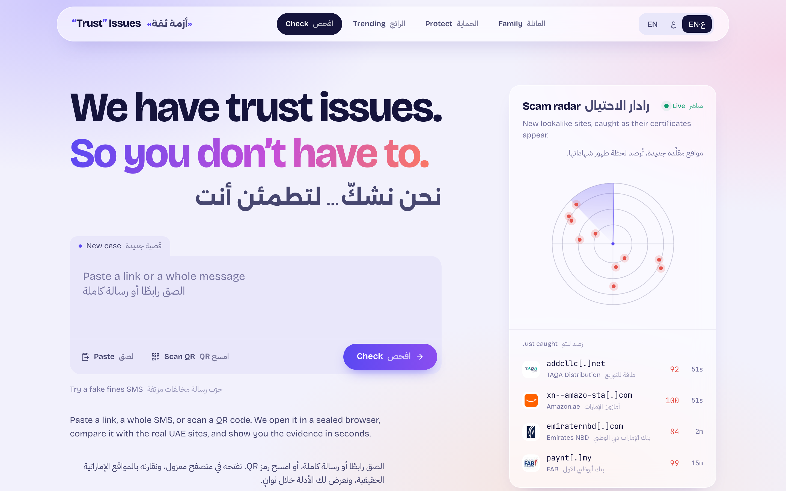

| Verdict as a case file | Spot the difference and real vs fake |
|---|---|
| 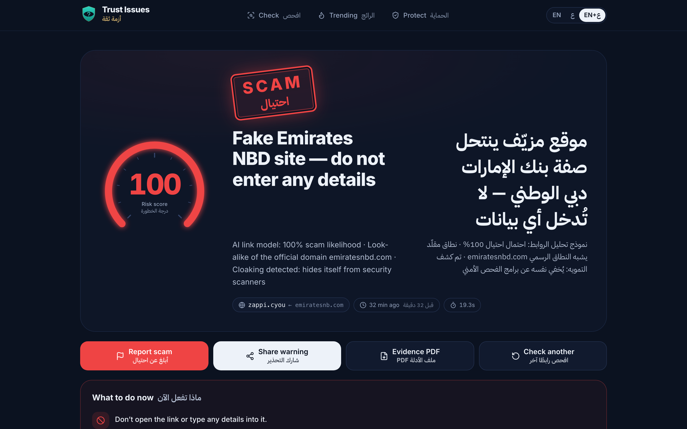 | 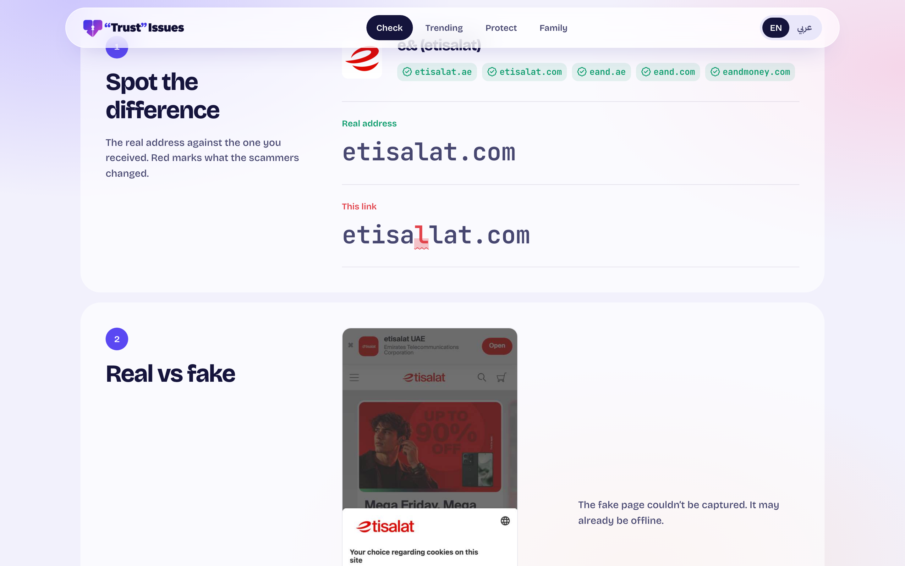 |
| **Police console: live radar** | **Police console: cases** |
| 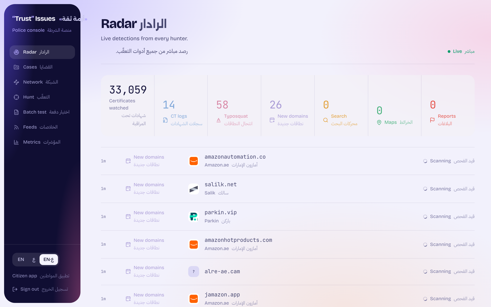 | 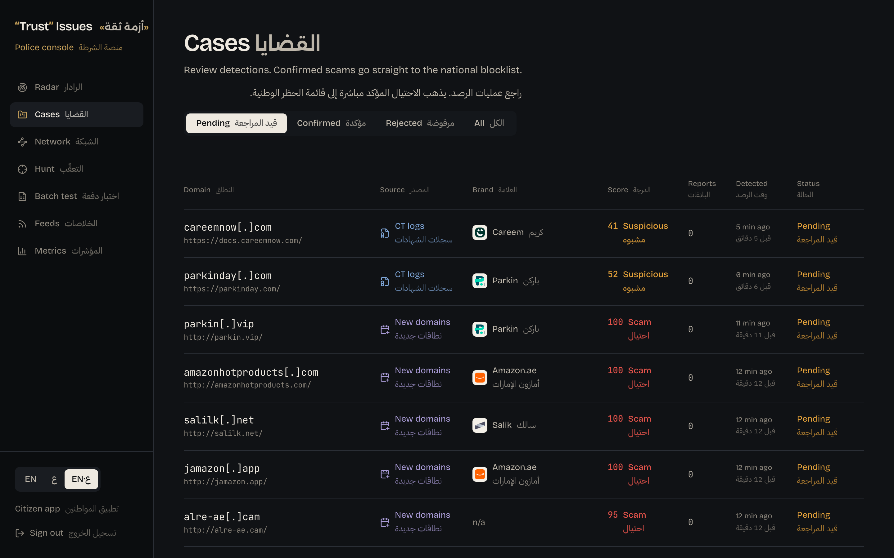 |

**Family Shield: the guardian approves a held site, and Mum's phone gets a simple home with SOS** (live site, real DNS decisions)

<p align="center">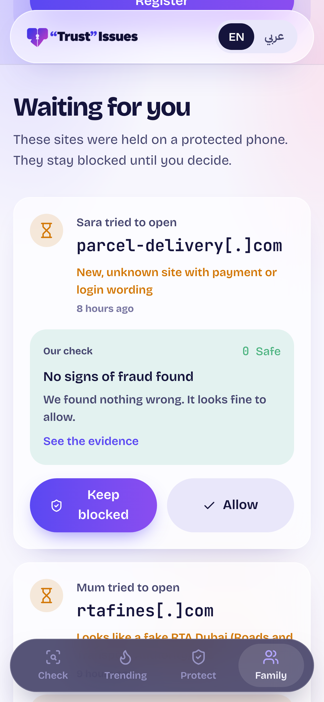 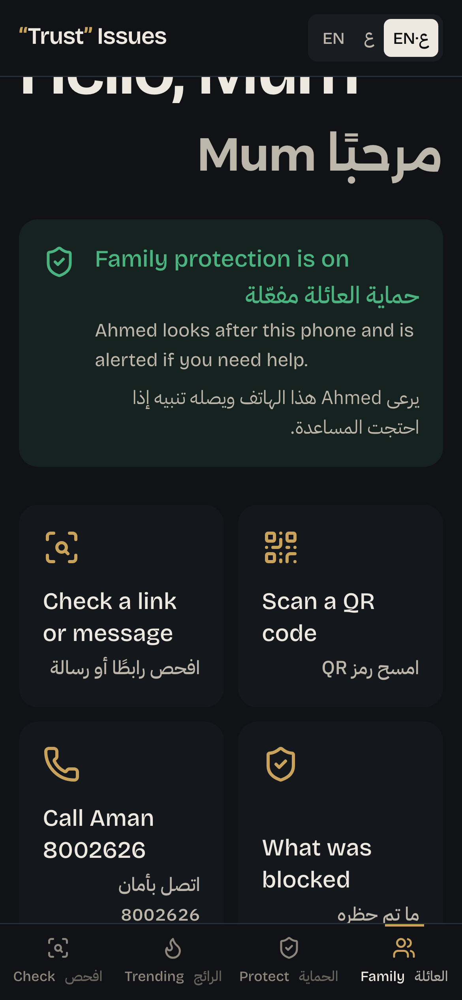</p>

<p align="center">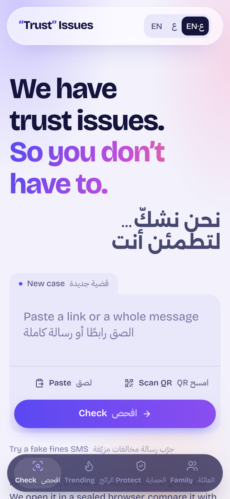 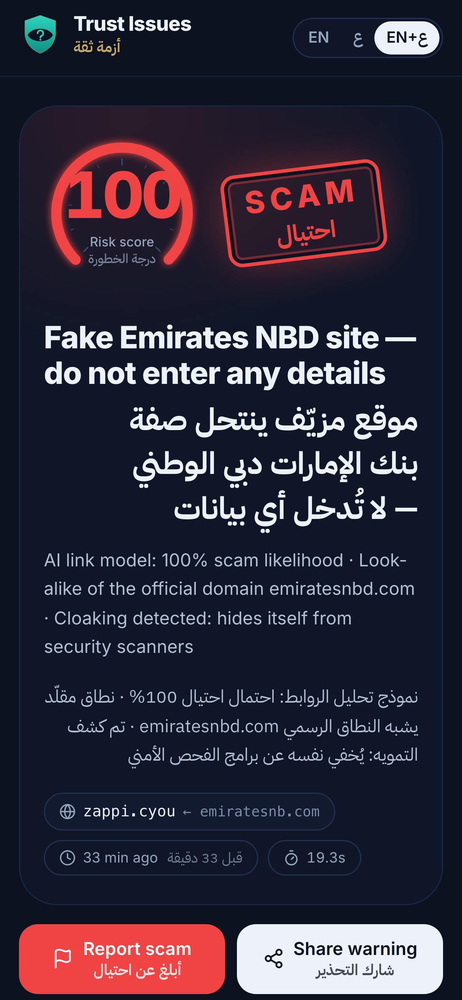 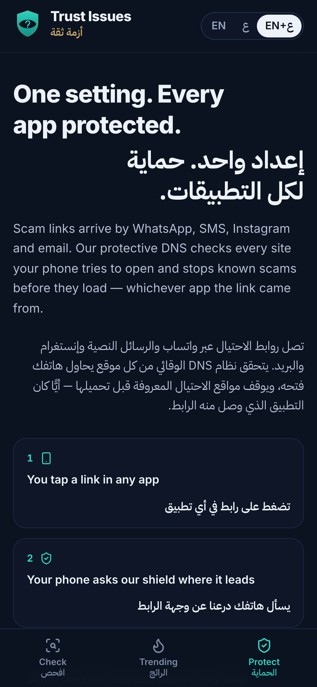 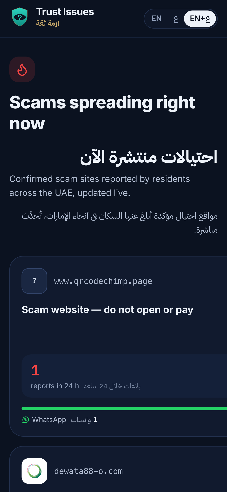</p>

**1-minute demo video:** [`docs/Trust-Issues-Demo.mp4`](docs/Trust-Issues-Demo.mp4), recorded from the running product on live data.

**Pitch deck:** [`docs/Trust-Issues-ScamShield.pptx`](docs/Trust-Issues-ScamShield.pptx) and [PDF](docs/Trust-Issues-ScamShield.pdf). The animated version is [`docs/deck/index.html`](docs/deck/index.html): open it in a browser and use the arrow keys.

## 3. How detection works

```mermaid
flowchart LR
  A[Link / message / QR] --> T0[T0 Trust anchors<br/>399 official UAE domains · Tranco]
  T0 --> T1[T1 Threat intel<br/>Safe Browsing · VirusTotal · URLhaus · urlscan · live feeds]
  T1 --> T2[T2 URL ML model<br/>LightGBM + char n-grams]
  T2 --> T3[T3 Domain intel<br/>RDAP/WHOIS · DNS · ASN · TLS · CT]
  T3 --> T4[T4 Sandbox render<br/>3 personas · redirects · cloaking]
  T4 --> T5[T5 Exfiltration leads<br/>Telegram bots · webhooks · phones]
  T5 --> T6[T6 Visual + AI judges<br/>favicon hash · Claude + GPT vision]
  T6 --> F[Fusion<br/>explainable score 0-100]
  F --> O[Verdict · bilingual reasons · evidence pack · blocklist]
```

- **Low false positives by design.** The trust-anchor layer (399 verified official UAE domains, `*.gov.ae`, Tranco top sites) caps the score of genuine banks and government sites. Shared hosts (pages.dev, vercel.app, duckdns…) never inherit trust.
- **Resists evasion.**
  - It follows shorteners and multi-hop and JavaScript redirects.
  - It opens every page as **3 personas** (UAE iPhone with `ar-AE`, desktop, Googlebot). A different page for crawlers is reported as **cloaking**.
  - It keeps working on pages that are already offline, using the URL model and domain intelligence.
- **Brand-intent rule.** If a page *claims to be brand X* and *collects card, OTP, Emirates ID or a password*, but the domain is not one of X's official domains, it is a scam.
- **Dual AI judges.** The screenshot, Arabic/English text and evidence are reviewed by Anthropic Claude (Opus 5.5, fast mode) and by an independent OpenAI vision model. Each returns a verdict, a confidence and reasons in both languages.
- **Explainable.** Every signal carries a weight and a reason in English and Arabic. The final score is a calibrated sum of those weights, so every verdict can be traced back to its evidence.
- **Scam networks.** Domains are linked through shared IPs, name servers, favicon hashes, phishing-kit DOM hashes, phone/WhatsApp numbers and Telegram bot tokens. **One takedown reveals the whole campaign.**
- **Police-ready evidence.** The PDF/JSON pack contains:
  - screenshots, the redirect chain and RDAP/WHOIS;
  - registrar and hosting abuse contacts;
  - UTC and GST timestamps and **SHA-256 chain-of-custody hashes**;
  - pre-written registrar and host takedown emails;
  - a shareable bilingual **warning card** to post back into the WhatsApp group.

## 4. Accuracy (measured on real, unseen data)

The URL model was trained on data with a time cutoff. It was then tested on **phishing URLs first seen after the training cutoff** (OpenPhish / Phishing.Database) and on legitimate URLs from unseen domains. Domains never overlap between train and test. Full numbers are in [`ml/metrics.json`](ml/metrics.json).

The full system was also run in fast mode (no sandbox, no AI, **live feeds switched off**) on held-out real URLs:

| Test set | Precision | Recall | F1 | False positives |
|---|---|---|---|---|
| 150 live phishing URLs + 411 official UAE bank and government sites | **1.000** | 0.967 | 0.983 | **0 / 411** |
| 1,200 held-out real URLs (600 phishing first seen after the training cutoff + 600 legitimate, unseen domains) | 0.974 | 0.935 | 0.954 | 15 / 600 |

The same sets were then run in deep mode (sandbox + both AI judges on uncertain URLs), still with **live feeds and threat-intel APIs switched off**, using `app.cli scan --deep --no-feeds`:

| Test set (deep mode, AI judges on) | Precision | Recall | F1 | False positives |
|---|---|---|---|---|
| 150 live phishing URLs + 411 official UAE bank and government sites | **1.000** | **0.993** | **0.997** | **0 / 411** |
| 500 held-out real URLs (250 phishing first seen after the training cutoff + 250 legitimate, unseen domains) | 0.992 | 0.944 | 0.967 | 2 / 250 |

One of the two remaining "false positives" (`dapurmiemicin.com`) is a hijacked domain now serving an illegal online-gambling site. With live feeds and threat-intel APIs switched on (the default), known phishing is matched instantly as well.

## 5. Technical choices, tools, APIs and data

| Area | Choice |
|---|---|
| Backend | Python 3.12, FastAPI, SQLModel (SQLite / PostgreSQL), asyncio, Server-Sent Events |
| Sandbox | Playwright Chromium, headless and isolated, never submits forms |
| ML | LightGBM + TF-IDF char n-gram logistic regression, calibrated; domain-only model for the DNS fast path |
| AI judges | Anthropic API (`claude-opus-5-5`, fast mode, structured JSON output) and OpenAI Responses API (vision), run in parallel |
| Threat intel APIs | Google Safe Browsing v4, VirusTotal v3, abuse.ch URLhaus, urlscan.io |
| Open data | OpenPhish community feed, Phishing.Database, PhiUSIIL dataset (UCI, CC BY 4.0), Tranco top-1M, Common Crawl |
| Hunters | Certificate Transparency logs (RFC 6962, polled directly), dnstwist, WhoisDS newly registered domains, SerpAPI (Google Search + Google Maps) |
| Domain intel | RDAP (rdap.org), WHOIS fallback for `.ae`, Team Cymru IP→ASN, crt.sh |
| Protective DNS | DNS-over-HTTPS (RFC 8484) resolver with dnslib, Apple `.mobileconfig` profile, RPZ zone and STIX 2.1 exports |
| Notifications | Web Push (VAPID) via pywebpush |
| Evidence | ReportLab PDF and Pillow warning cards with Arabic shaping (arabic-reshaper + python-bidi), IBM Plex Sans Arabic (OFL) |
| Graph | networkx connected components → Cytoscape.js |
| Front-end | React + TypeScript + Vite PWA, Tailwind, framer-motion, Cytoscape.js, Leaflet; Arabic / English / side-by-side modes with RTL |
| Deploy | One Docker image (Python slim + headless Chromium, 754 MB) on Render with PostgreSQL (`render.yaml` blueprint) |

## 6. Build and run

### Option A: Docker (everything in one container)
```bash
cp .env.example .env   # add your API keys (all optional; more keys = more intel)
docker build -t trust-issues .
docker run --env-file .env -p 8000:8000 trust-issues
```
Open http://localhost:8000. The police console is at `/console` and uses `CONSOLE_PASSWORD`.

### Option B: local development
```bash
cd backend
uv sync
uv run playwright install chromium
uv run uvicorn app.main:app --port 8000
```
```bash
cd web
npm install
npm run dev        # http://localhost:5173 (proxies /api to :8000)
```

### Option C: deploy on Render
1. Render dashboard → **New → Blueprint** → connect `m4hdhi/trust-issues`. Render reads `render.yaml` and creates the web service and a PostgreSQL database.
2. When asked, paste the values from your local `.env` (API keys, `CONSOLE_PASSWORD`, `VAPID_PUBLIC_KEY`, `VAPID_PRIVATE_KEY`).
3. Use the **Standard** plan (2 GB RAM) or larger: the sandbox browser needs more than the 512 MB of the smaller plans.
4. The public URL (`https://<name>.onrender.com`) is picked up automatically for phone profiles, push links and takedown emails.

### Batch-test a list of URLs (for the hidden test set)
```bash
cd backend
uv run python -m app.cli scan your_urls.csv -o results.csv          # fast mode, thousands of URLs
uv run python -m app.cli scan your_urls.csv -o results.csv --deep   # also sandbox + AI for uncertain URLs
```
The CSV needs a `url` column (or one URL per line). If it also has a `label` column (`phishing`/`legitimate` or `1`/`0`), precision, recall and F1 are printed. You can also upload the same CSV in **Console → Batch test**.

### Protect a phone
Open the web app → **Protect my phone**.
- **iPhone:** download the profile → Settings → Profile Downloaded → Install.
- **Android:** install *Intra* or *RethinkDNS* and paste your personal DoH URL.

Turn on alerts to receive a push notification each time a scam is blocked.

### Chrome extension
`chrome://extensions` → Developer mode → **Load unpacked** → select the `extension/` folder → set the backend URL in its options.

### Retrain the URL model
```bash
cd backend
uv run python ../ml/build_dataset.py && uv run python ../ml/train_url_model.py && uv run python ../ml/evaluate.py
```

## 7. Privacy and safety
- The DNS resolver sees **domain names only**, never full URLs or message content. Allowed lookups are not logged. Only block events are stored, against a random device ID.
- Family Shield shows the guardian **only blocked or held domains**, never the family member's normal browsing. A family stores a display name per phone and, optionally, the guardian's number for the Call button. Any member can leave, and the guardian can remove a phone at any time. Registering is optional and stores only the email address. Sign-in codes are kept as salted hashes, expire after 10 minutes and are cancelled after 5 wrong tries.
- Community reports are anonymous and trust-weighted. Official domains cannot be blocked by reports.
- The sandbox only reads pages. It never submits forms or credentials.
- Takedown emails are drafted for an officer to review. Nothing is sent automatically.

## 8. Honest limitations
- DNS blocking works per domain. A scam hidden in a *path* on a shared host is caught by link checks and the extension, not by DNS.
- On Android, system-wide blocking needs a DoH client app (Intra/RethinkDNS) until a native app ships or telcos consume our RPZ feed.
- Phishing kits that geofence to UAE IP addresses need a UAE egress proxy in production.
- Search and Maps hunting depends on SerpAPI quotas (the free plan has 250 searches a month). Background hunts rotate through the queries and pause when 100 searches are left, so console hunts keep working. A pilot would use direct Google APIs.
- Free VirusTotal keys allow 4 lookups a minute. Lookups beyond that are skipped, not queued, so a big batch gets VirusTotal evidence only for some URLs.
- The AI judges add cost and latency, so they run only on deep scans of non-official sites.

## 9. Pilot route with Abu Dhabi Police
1. Analysts use the console on reported links and radar detections. Evidence packs go straight to case files.
2. The **RPZ feed** is published to e&, du and TDRA DNS firewalls, which blocks confirmed scams for every phone in the UAE with no app.
3. Bank fraud teams subscribe to brand-specific alerts, for example every new ADCB look-alike.
4. Citizens get the PWA, the extension and, later, a native Android app that scans incoming message notifications.
